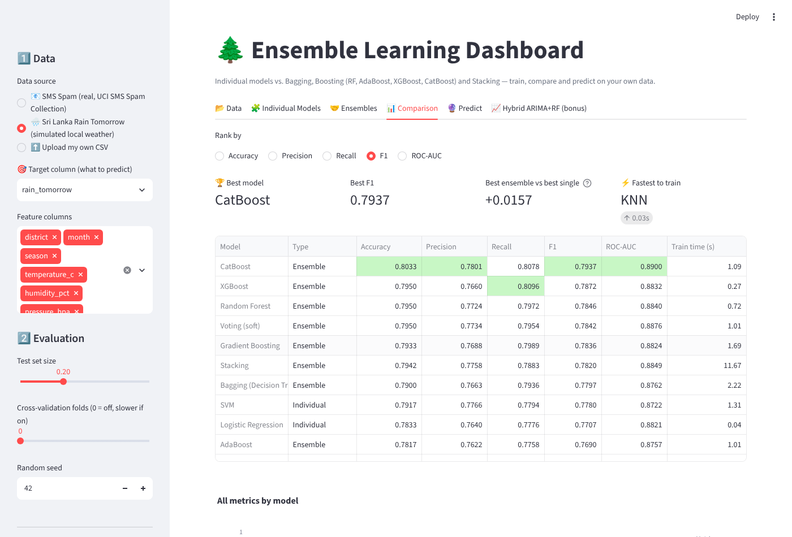

# 🌲 Ensemble Learning Dashboard — Random Forest vs XGBoost vs Stacking

A small interactive dashboard + analysis notebook for comparing **individual classifiers** with **ensemble methods**
(Bagging, Random Forest, AdaBoost, Gradient Boosting, XGBoost, CatBoost, Voting and Stacking) on your own data.

Built for the *Ensemble Learning* assignment (MSc in AI, University of Moratuwa):

| Assignment requirement | Where |
|---|---|
| Upload a data file | Sidebar → **Upload my own CSV** (or use the two sample datasets) |
| Individual models (Decision Tree, Logistic Regression, SVM, KNN, Naive Bayes) | **🧩 Individual Models** tab |
| Ensembles – bagging & boosting strategies (Bagging, RF, AdaBoost, Gradient Boosting, XGBoost, CatBoost for categorical data) | **🤝 Ensembles** tab |
| Stacking | **🤝 Ensembles** tab → *Stacking* (RF + XGBoost + SVM/NB → Logistic Regression) |
| Comparison dashboard | **📊 Comparison** tab (metrics table, charts, ROC curves, CV, feature importance, automatic interpretation) |
| Inference, e.g. "is this email/SMS spam?" | **🔮 Predict** tab (type a message, fill a form, or batch-score a CSV) |
| *Optional:* ARIMA combined with Random Forest for weather time series | **📈 Hybrid ARIMA+RF (bonus)** tab |
| Notebook comparing RF vs XGBoost vs Stacking + interpretation of strengths/limitations | `notebooks/RF_vs_XGBoost_vs_Stacking.ipynb` (and an `.html` export) |



---

## 1. Project structure

```
ensemble-dashboard/
├── app.py                         # Streamlit dashboard (run this)
├── run_app.bat                    # Windows one-click launcher
├── requirements.txt
├── src/
│   ├── ml_core.py                 # preprocessing, model catalogue, training & evaluation
│   ├── hybrid_ts.py               # SARIMA + Random Forest hybrid (time series)
│   └── generate_data.py           # re-creates the simulated Sri Lanka weather datasets
├── data/
│   ├── sms_spam.csv               # REAL: UCI SMS Spam Collection (5,572 messages)
│   ├── sri_lanka_rain.csv         # SIMULATED: 13 districts, monsoon seasons, rain tomorrow Yes/No
│   ├── colombo_monthly_rainfall.csv  # SIMULATED: monthly rainfall 1990-2025 (time series)
│   ├── sample_new_messages.csv    # try batch prediction with these (spam dataset)
│   └── sample_new_weather.csv     # try batch prediction with these (rain dataset)
├── notebooks/
│   ├── RF_vs_XGBoost_vs_Stacking.ipynb   # analysis + interpretation (already executed)
│   └── RF_vs_XGBoost_vs_Stacking.html    # same, viewable in any browser
└── docs/                          # screenshots
```

> **About the data:** the SMS data is real public data. The weather datasets are **simulated** – generated with
> Sri Lanka's real climate pattern (SW monsoon May–Sep on the wet zone, NE monsoon Dec–Feb on the dry zone/east,
> inter-monsoon rains) because raw Department of Meteorology data is not openly downloadable.
> Any real CSV can be uploaded instead – the app detects column types automatically.

---

## 2. How to run (Windows)

### Option A – one click
1. Install **Python 3.10 – 3.13** from <https://www.python.org/downloads/> (tick **“Add python.exe to PATH”** during install).
2. Double-click **`run_app.bat`**.
   The first run creates a virtual environment and installs the packages (~3–5 min). The dashboard then opens at
   <http://localhost:8501>. Next time it starts in a few seconds.

### Option B – terminal (PowerShell / CMD / VS Code terminal)
```bash
cd "C:\Users\<you>\Desktop\Clude ai\ensemble-dashboard"
python -m venv venv
venv\Scripts\activate            # macOS/Linux: source venv/bin/activate
pip install -r requirements.txt
streamlit run app.py
```
Stop the app with **Ctrl + C** in the terminal.

> PowerShell error *“running scripts is disabled”* when activating? Run once:
> `Set-ExecutionPolicy -Scope CurrentUser RemoteSigned`, or use CMD instead.

### Run the notebook
```bash
venv\Scripts\activate
jupyter notebook notebooks/RF_vs_XGBoost_vs_Stacking.ipynb
```
Then *Kernel → Restart & Run All* (≈ 3–4 min, stacking CV is the slow part).
You can also open it in **VS Code** (select the `venv` interpreter) or upload it to **Google Colab**
(upload the `src/` and `data/` folders too, keeping the same structure).
The `.html` file shows the executed notebook without running anything.

### Re-generate the simulated datasets (optional)
```bash
python src/generate_data.py
```

---

## 3. How to use the dashboard

1. **Sidebar → Data:** choose *SMS Spam*, *Sri Lanka Rain*, or upload a CSV. Pick the **target column** and the feature columns.
   - Numeric columns → median-imputed + scaled · categorical → one-hot (CatBoost uses them natively) · long text → TF-IDF.
2. **🧩 Individual Models:** tick models, optionally change hyper-parameters, click **Train**.
3. **🤝 Ensembles:** choose bagging / boosting / combining models, click **Train**. The stacking meta-learner weights are shown.
4. **📊 Comparison:** ranking, best model, ensemble-vs-single gain, grouped metric chart, accuracy-vs-training-time,
   ROC curves, cross-validation (set *CV folds* in the sidebar), feature importance and an automatic written interpretation.
   Download the table as CSV.
5. **🔮 Predict:** pick a trained model →
   - spam data: paste a message → spam/ham + probability
   - tabular data: fill the auto-generated form → prediction
   - batch: upload `data/sample_new_messages.csv` or `data/sample_new_weather.csv` → download predictions
   - download the trained model as `.pkl`.
6. **📈 Hybrid ARIMA+RF:** compares SARIMA, Random Forest and SARIMA + RF-on-residuals on monthly rainfall (or your own monthly series).

**Your own CSV format:** one row per sample, one column for the label (e.g. `spam`/`ham`, `Yes`/`No`, `churn`/`stay`),
other columns are features. 2–20 classes. Example ideas: your own spam emails (subject/body text column + label),
recruitment data, customer churn, weather records.

---

## 4. Key results (from the notebook)

| Model | Rain CV-F1 (5×2 CV) | SMS CV-F1 (5-fold) | Training time (rain) |
|---|---|---|---|
| Decision Tree | 0.713 | – | 0.06 s |
| Logistic Regression | 0.793 | 0.875 | 0.03 s |
| Naive Bayes | – | 0.914 | – |
| Random Forest | 0.797 | 0.930 | 0.7 s |
| XGBoost | 0.789 | 0.907 | 0.2 s |
| **Stacking** | **0.799** | **0.947** | 11.5 s |

* Ensembles beat a single tree by ~0.08 F1 (variance reduction).
* On mostly-additive tabular data, RF / XGBoost / Stacking / CatBoost are within ~0.01 F1 – RF gives the best accuracy-per-effort.
* On sparse, imbalanced text, **Stacking gives a clear, significant and more stable gain** thanks to diverse base models (NB + RF + XGBoost).
* XGBoost overfits with a high learning rate (0.3) – it needs tuning; RF does not.
* Full discussion of strengths & limitations: section 5 of the notebook.

---

## 5. Upload to GitHub

1. Create a new empty repository on <https://github.com/new> (e.g. `ensemble-learning-dashboard`, no README).
2. In the project folder:
```bash
git init
git add .
git commit -m "Ensemble learning dashboard: RF vs XGBoost vs Stacking"
git branch -M main
git remote add origin https://github.com/<your-username>/ensemble-learning-dashboard.git
git push -u origin main
```
(First push asks you to sign in – use the browser login or a Personal Access Token as the password.)

### Optional: deploy online for free (Streamlit Community Cloud)
1. Go to <https://share.streamlit.io>, sign in with GitHub.
2. **Create app** → choose the repo, branch `main`, main file `app.py` → **Deploy**.
3. Share the public link with your lecturer.

---

## 6. Tech stack
Python · Streamlit · scikit-learn · XGBoost · CatBoost · statsmodels · Plotly · pandas · Jupyter

Dataset credit: *SMS Spam Collection* – T. A. Almeida & J. M. Gómez Hidalgo, UCI Machine Learning Repository.
